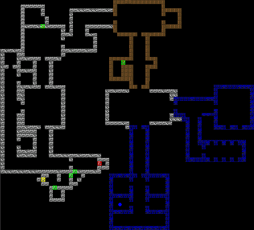

# Wolf3DOrig for Agon

An experimental, playable port of the original *Wolfenstein 3D* shareware
experience to the Agon family of retrocomputers.

This is no longer merely a map extractor or a distant porting plan. It is a
working split-machine game: eZ80 assembly owns the authoritative
simulation, while a bespoke ESP32 VDP extension performs the Wolf3D raycast,
sprite projection, HUD composition, view-weapon drawing, double-buffered
presentation, and death fizzle. The two processors exchange compact commands
and asynchronous completion packets over Agon's normal VDU stream.

> **Experimental educational project.** This repository is not an official id
> Software, Bethesda, ZeniMax, or Agon Platform product. It is not intended for
> sale or commercial exploitation.

> **AI authorship disclosure.** This project in its present form—including the
> application code, VDP integration, asset tooling, regression fixtures, and
> technical documentation—was LLM-generated by **OpenAI Codex using ChatGPT
> 5.6 Sol**. The human Author supervised the work: setting requirements,
> making architectural and product decisions, reviewing behavior, and testing
> extensively in emulation and on physical hardware. Codex also reused and
> adapted some of the Author's earlier hand-written eZ80 assembly routines,
> established Agon idioms, assets, and prior development work. Codex is the
> principal implementation author of the current project; the human Author is
> its designer, director, domain expert, hardware pilot, and maintainer.

## Controls

| Key | Action |
|---|---|
| `W` / `S` | Move forward / backward |
| `A` / `D` | Strafe left / right |
| Left / Right | Turn |
| Up Arrow | Use/open door |
| Space | Attack |
| `1`–`4` | Knife, pistol, submachine gun, Gatling gun |
| Escape | Exit cleanly to MOS |


## What works today

The current Episode 1, level 1 fixture is playable in the bespoke emulator and
has been exercised extensively on physical Agon hardware. Implemented systems
include:

- the real 64×64 E1L1 map, wall art, doors, static decorations, pickups,
  actors, HUD, and digitized effects;
- deterministic 30 Hz eZ80 simulation, independent of variable VDP rendering
  performance;
- callback-gated asynchronous rendering with one frame in flight and tear-free
  double buffering;
- WASD movement, strafing, tuned wall/door/static/actor collision, and moving
  center-plane doors with recessed wells;
- original-style area connectivity, patrols, sight, awareness, reaction
  delays, chase/dodge behavior, and ordinary enemy attacks;
- knife, pistol, submachine gun, and Gatling gun selection, animation,
  targeting, damage, pain/death chains, scoring, drops, and extra lives;
- player damage, death turn, red fizzle, lives, respawn, and complete attempt
  reseeding;
- native-rate sound effects, original priority arbitration, three simultaneous
  VDP channels, and mono distance/direction attenuation; and
- clean Escape-to-MOS shutdown with restoration of the caller's display mode.

Music, bosses, projectiles, level completion, menus, high-score entry, splash
screens, and general multi-level loading remain future work. Application
version `Wolf3DOrig App 0.1.0 Alpha 1` is currently printed during bootstrap;
it will eventually live prominently in the opening screens and menu.



## Architecture

The design accepts Agon's VDP as effectively write-only from the eZ80 game's
point of view. Persistent game state therefore stays on the eZ80. Only dirty
world snapshots cross the wire; static objects cost nothing after setup.

```text
eZ80 application                         ESP32 VDP extension
──────────────────────────────────       ─────────────────────────────
input + fixed-step clock                 typed Wolf world mirror
doors, actors, inventory, AI      ───▶   column DDA raycaster
combat, collision, audio events          walls, doors, sprites and HUD
authoritative player/world state   ◀───  W3DR completion notifications
validated presentation decision          hidden-buffer rendering
```

Simulation catches up in binary-friendly four-tick quanta from MOS's 120 Hz
clock. Rendering may become slower without changing world velocity or allowing
held keyboard input to accumulate into unintended motion. The result is a game
that remains responsive and temporally correct even when the VDP is heavily
loaded.

The custom renderer lives in the separate `agon-vdp-wolf3d` repository. A
separately qualified integration effort combines Wolf3DOrig and Pingo in one
VDP without merging their command spaces or persistent state.

## Repository map

- `src/asm/wolf3d/` — the production eZ80 application and detailed build/run
  documentation.
- `src/asm/wolf3d_*` — isolated host-oracle and real-eZ80 regression projects
  for gameplay, actors, areas, awareness, chase, combat, death, and audio.
- `agonport/tools/wolf3d_assets/` — durable extraction, conversion, AGNB
  packing, fixture-generation, and validation tools.
- `agonport/doc/` — architecture decisions, protocol handoffs, devlogs,
  hardware qualification, and the story of the first correct render.
- `src/toolchain/` — earlier WL1 map/texture/audio exploration and utilities.
- `src/assets/maps/orig/` — tracked reference overview images used by the
  original map-analysis phase.
- `orig/` — local reference source and game data, deliberately ignored and not
  distributed by this repository.

Start with [the production eZ80 client guide](src/asm/wolf3d/README.md),
[the first correct-render account](agonport/doc/first_correct_render_success_story.md),
and [the current development log](agonport/doc/devlog_20260731_static_render.md).

## Building the current client

The client requires the project's established Agon/eZ80 toolchain and its
generated AGNB assets. From the repository root:

```bash
cd src/asm/wolf3d/src
ez80asm wolf3d.asm ../tgt/wolf3d.bin
```

The detailed guide documents asset generation, regressions, emulator profiles,
SD-card deployment, and firmware boundaries. Generated targets and original
reference material are intentionally not treated as ordinary source files.

## Licensing, rights, and permitted purpose

This repository is a noncommercial educational and historical-engineering
exercise. It studies an important early 3D game, translates behavior into new
eZ80 assembly and ESP32 code, and documents the result for learning, research,
preservation, and experimentation. It is not offered as a commercial product.

The Author claims no ownership of *Wolfenstein 3D*, its names, trademarks,
characters, maps, textures, sprites, sounds, music, source code, or other
third-party material. Those rights remain with their respective owners.

For the Author's own original contributions to this project, the Author's
intent is to retain **no rights whatsoever**, to the fullest extent that such a
waiver is legally possible. This statement cannot surrender, relicense, or
override rights belonging to id Software, Bethesda, ZeniMax, the Agon Platform
authors, toolchain authors, asset creators, or any other third party. It also
does not grant rights to trademarks or to material that the Author never
owned.

The original Wolfenstein 3D reference source used during development is
governed by id Software's **Limited Use Software License Agreement**, described
in its accompanying `LICENCE.DOC`; project records treat it as educational-use
reference material rather than assuming a permissive open-source license.
Game-data and artwork rights are separate from source-code rights. Local
reference copies live under the ignored `orig/` boundary and are not intended
to be redistributed from this repository.

Anyone cloning, building, modifying, distributing, or demonstrating this work
is solely responsible for:

- obtaining any required lawful copy of the original game data;
- reading and complying with every applicable source, data, artwork, audio,
  trademark, toolchain, and dependency license; and
- determining whether their intended use is permitted in their jurisdiction.

Nothing here is legal advice, and the repository's presence does not imply
permission from any third-party rights holder.

## No warranty or liability

This project is provided **AS IS**, without warranties or conditions of any
kind, express or implied, including fitness for a particular purpose,
merchantability, noninfringement, correctness, safety, or compatibility with
any hardware or software.

To the fullest extent permitted by law, the Author assumes **no liability
whatsoever** for any claim, loss, damage, legal exposure, hardware failure,
data loss, firmware corruption, lost profits, or other consequence arising
from possession, study, building, modification, distribution, or use of this
project. You use it entirely at your own risk.

## Credits

- **OpenAI Codex, using ChatGPT 5.6 Sol**, is the principal implementation
  author of the current port. It generated nearly all of the present eZ80 game
  code, custom-VDP integration, Python asset pipeline, regression suites,
  diagnostics, and documentation through an extended supervised development
  session.
- **The project Author** conceived and directed the project; established its
  architecture and behavioral requirements; supplied domain knowledge,
  existing hand-written assembly routines, reusable Agon code and idioms, and
  prior development assets; performed visual and physical-hardware acceptance;
  and made the design, scope, compatibility, and release decisions. The Author
  supervised the LLM rather than manually writing most of the current port.
- id Software created *Wolfenstein 3D* and published the reference source used
  to understand its behavior.
- The Agon Platform community created the hardware, MOS, VDP, emulator, and
  development ecosystem that made this experiment possible.

This repository exists because understanding old machines—and making them do
something delightfully unreasonable—is worthwhile in its own right.
