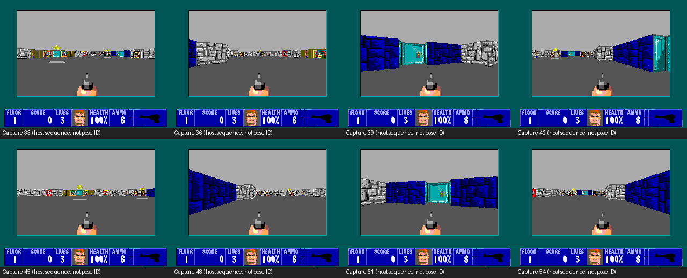

# Missing-rotation investigation: first Oryx result

The unchanged paced fixture visibly rotates on both Oryx and hardware. In the
immediate visible-only hardware repeat, the Author watched native VGA and
confirmed both full turns. No fixture or firmware fix was needed. The Author
finds it jerkier than ordinary play and will compare spinning in the live game
later; ordinary gameplay performance remains unverified. The original report
of no visible motion was not reproduced in this explicitly announced repeat.

[Animated samples](results/rotation.gif) contain one display capture per host
second; this is a coarse diagnostic sequence, not the game's actual cadence
or a calibrated video. Capture numbers are host sequence numbers, not pose IDs.
All 59 snapshots, host capture times, raw timing/native records, decoded CSV
and complete runner/backend reports are retained under `results/original/`.
Lossless PNGs preserve the captured pixels; `frames.json` records the raw PPM
hashes, with original PPM files retained in ignored `build/original-raw/`.

## What was checked

1. E1L1 tile (34,36) is open floor in the actual packaged tilemap. The fixture
   remains centered at (34.5,36.5), with zero enemies. Nearby south door and
   retained room geometry are visible in the captures.
2. The fixture writes each scripted heading into the player's pose, marks the
   real player delta dirty, uploads the production 28-byte batch and invokes
   APPLY_AND_RENDER. Decoding validates the resulting native mirror heading
   against every submitted pose. The renderer reads that mirror heading to
   construct the view. No replacement renderer is used.
3. The paced mode issues C3 after render completion and then an ordered INFO0
   fence. Displayed captures show distinct door, room and wall views, including
   repeated orientations during the second turn. This adds displayed-pixel
   evidence missing from PERF-001's automated qualification.
4. This run completed 430 poses, 215 in each revolution, final step 600; 170
   scripted poses were coalesced. Timer-restored output and native identities
   passed, with normal application return, ordinary SDL Quit, exit status 0
   and no reported backend fault counters. Diagnostic capture overhead means
   this run is not promoted as a new performance baseline.
5. The exact tested application SHA-256 is
   `90eb73ee8e28d27a39bc374ad6d020024d483164aedfcc23e8b0e2169f7941fe`;
   module is `27f3d39285a5b49fec8aeed35085b1916ef537154f1d1d53956b075e00174c82`.
   Both match the physical staged cohort. The Oryx firmware is a50eb23a…;
   hardware used diagnostic8ade1e7d…. These are different runtime images.
6. The retained r2 source runtime differs from the a50 source runtime in
   surrounding diagnostic logging. That comparison alone cannot establish the
   installed binary's behavior: the available r2 ELF does not reproduce its
   historical embedded identity. No guessed firmware/ELF pairing was run.
   A read-only evidence question was sent to the VDPlet owner for any existing
   physical row/swap defect evidence and the exact matching r2 ELF location.

## Reservation and remaining work

Oryx request dde4c8240310 checked out generation 284 with fresh whole-host idle
proof. One of the maximum three authorized headless invocations ran; it took
58.35 host seconds including startup and readout. No unexpected failure
occurred. Results were retrieved and the machine freshly inspected idle, then
released at 11:03:40 EST; `results/release.json` records no successor. No new
physical contact, firmware changes, GUI launch, build or production edit was
performed. The isolated profile is stopped at:
`/home/smith/Agon/mystuff/Wolf3dOrig/.emulator/wolf-perf-002-r01/original`.

WOLF-PERF-002-01/-02 are complete for source trace and Oryx reproduction.
-03 remains open for a justified correction if a defect is identified; none is
currently demonstrated. -04 has headless displayed-output evidence but still
needs the physical discrepancy resolved. -05 retains Author visual acceptance.
Further physical investigation needs a finite prepared cohort and normal bench
custody; this Oryx test does not establish a successful hardware presentation.

## Runtime-owner evidence return

Reply `2026-11-04_11-08-52_vdplet_wolf-perf002-runtime-evidence-reply-one`
confirms that the exact r2 ELF (embedded identity9659bf67…) was already recorded
unavailable in the November3 provenance exchange. Nearby cached ELFe6cd75cf…
is a different build; no exact r2 emulator replay is possible from these
retained artifacts. The same r2 image historically supported five direct-row
starts with older consumer binaries, but no established physical r2-versus-a50
swap defect was identified. The known discovery startup race has a different
signature from hundreds of successful render calls. No firmware workaround or
fixture correction follows from those records. The substantive reply is
retained in `results/runtime-evidence-reply.json`.

The physical paced operation lasted96.15 host seconds, of which20.12 nominal
MOS seconds were the scripted rotation interval. Startup and stopped readout
are outside that interval. CPU mode never animates and unpaced mode keeps
intermediate frames hidden. These boundaries explain why much of the suite
would look stationary; they do not explain away the Author's observation or
prove that the paced views appeared. Any physical follow-up should clearly
announce and visually qualify the active rotation window.

## Author confirmation of captured room

The Author confirms that the Oryx screenshots correctly represent the selected
room and the expected views. This accepts the captured scene appearance; the
physical missing-rotation observation remains unresolved.

## Visible-only hardware repeat — accepted by the Author

The Author selected an immediate slot without waiting for the audio enhancement.
Generation28 ran exactly one original paced application, unchanged90eb73ee… /
module27f3d392… on the same native diagnostic8ade firmware. All49 original
inputs and eight tools were checked, with a task-owned adapter narrowing the
order to paced and using fresh remote/evidence paths. No CPU/unpaced arm,
rebuild, audio enhancement, firmware change, reset or startup edit occurred.

The agent announced launch, then detected the first timed render (INVOKE token11)
and called out the actual rotation start. Stopped READ16 extraction identified
the end. The Author confirms both turns on native VGA; see HUMAN-REVIEW.md.
That establishes the intended moving scene appeared in this repeated cohort,
not why it was not noticed in the original run.

201 presentations completed, final step600,399 coalesced poses; raw PRT20,065
and MOS2,414. Nominal PRT rate10.0174 presentations/s, with200 presentation
intervals averaging99.76 nominal ms (median/p95/max100). The previous physical
paced arm had201 records, PRT20,064 and the same MOS2,414. This repeat supports
the fixture's measured cadence; neither is ordinary-game or calibrated optical
FPS. Mean inner render18,649,698.70 CCOUNT ticks; mean module call18,760,292.34.
The extra ordered C3/INFO fence and diagnostic runtime remain explicit.

Guest/native identities, timer restoration, executable code, balanced SP and
actual native mode0 restoration passed. Startup/listener full reads matched;
original cwd/CLI/cursor, neutral input, offline listener/idle worker and free
ports passed, including an independent cwd/USB check retaining the observation's
original epoch. Card left mounted. Central release11:37:11EST; Extender and
next FSIM request14afe4eae07d were immediately notified, with FSIM still needing
its own fresh grant. No Wolf hardware custody remains.

Portable raw records/reports/receipts are in `results/visible01/`; the report
reproduces exactly from archived binaries. Complete transport journals remain
in ignored PERF-001/build/olimex01/evidence/physical-r02-visible/ under the
original coordinator's guard. WOLF-PERF-002-01..-05 are disposed by this source,
emulator and accepted hardware evidence; -03 required no correction. -06 voice
preparation remains deferred after the Author selected the immediate unchanged
run. Speech was generated and audio-only source prepared, but no voice build,
emulator test or hardware playback is claimed.
