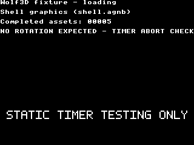

# Static timer fixture caption

The task-owned static timer-abort controls now display **STATIC TIMER TESTING
ONLY**, with **NO ROTATION EXPECTED - TIMER ABORT CHECK** in the loading text.
The large caption occupies x11–308/y183–196, inside the reserved strip between
the normal 3D viewport and HUD. Both loading pages are reconstructed with it.

The static fixture deliberately aborts after timer initialization. It checks
timer/vector/interrupt cleanup; it does not exercise a rotating renderer. Its
timer/abort bench body remains unchanged. Routine visual rotation reviews should
use an explicitly presenting rotation fixture, with a clear start announcement.

Four actual eZ80 guest assemblies passed in r02. Both unpaced timing binaries
are byte-identical to their PERF009 predecessors, including their package-size
operands; only the two static controls change output. The caption uses an owned
RGBA2222 bitmap through existing public VDU operations. ID0xf1b0 does not occur
in the470 actual asset buffer records. Setup paints through the existing paired
page update; cleanup drains Canvas, clears the owned buffer and fences ingress.
Source and actual listing checks establish this ordering; no physical caption
resource-retirement claim is inferred from Fab.

One Fab run on Oryx341 used the existing c8f native-source bridge and a separately
assembled static derivative retaining its Arthur bindings. The fifth-asset
branch holds each displayed page for two nominal MOS seconds with an explicit
present between holds. Fourteen identical captures from3.012–6.923 seconds show
the exact298×14 caption pixels throughout that interval. In total121 of730
retrieved captures contain the exact caption. Page identity follows the selected
source path; identical screenshots alone cannot distinguish buffer numbers.
The bridge reports one load/unload, zero renders/errors and no residual state.
This is visual source-model evidence, not Xtensa execution or hardware timing.

The guest returned normally to MOS, as RETURN.png records. The visual controller
incorrectly waited for loading3.bin, which this static derivative never writes.
After observing the MOS return, Wolf requested ordinary frontend quit. The
frontend returned0; the controller preserved passed:false / Unexpected frontend
exit. Its last queued capture was not written after quit;730 earlier captures
were retrieved. RESULT.json records a separate offline pixel check and that
failed controller result, without converting the original run into an automated
completion pass. The historical run_visual.py must not be reused until its
completion oracle is corrected for this exact static fixture. No replay was
performed to conceal the controller error.

The r01 actual build failed its unchanged-timed gate because assembler equality
syntax compiled the caption into timed modes. The r02 explicit Boolean guard
fixed that. The visual01 assembly separately failed on a missing helper after
donor trimming; visual02 retained the full donor body and assembled successfully.
Both failures and their source snapshots remain under build/. No failed guest
was dispatched. AMENDMENT-02.md and VISUAL-AMENDMENT-02.md retain the corrections.

The archive retrieved from Oryx matches SHA256
afc11cdd07ab78ff9abbcfbea540459d2c90496bd4b225cd10b304b1a79e2144.
The original run, captures, guards, input manifest and saved guest RAM are under
build/visual02/oryx-result/. report.py checks actual payload/source bindings and
caption pixels; RESULT.json includes per-frame hashes. Assembly and original
controller receipts are copied into evidence/. Compiler306/308 and Oryx341 were
released after owned children stopped. Fresh whole-host idle preceded Oryx
release at07:38:15UTC; next queue was empty. Peak observed Oryx CPU was62.75C,
with boost OFF. Hardware75 was already restored and cleanly released separately.

PERF009 PRESENTATION-CORRECTION.md separately explains the earlier stationary
room: the unpaced fixture draws600 changing poses into a hidden buffer and
presents once after timing ends. These results measure hidden draw capacity,
not visible/gameplay FPS. This caption change does not alter that fixture.
